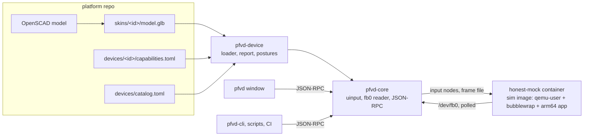

# Virtual device (pfvd)

**PocketForge Virtual Device** (`pfvd`) is a Linux desktop tool that shows a
PocketForge handheld as an orbitable 3D model with its live screen on the
display, and turns a click on a button, stick or trigger into the same evdev
input event the real device would send. It is host tooling for developers and
CI: it never ships in a device image.

!!! note "Repository access"
    pfvd's source lives in `pocketforge-os/pfvd`, which is private for now. The
    device models, descriptors and the simulator image it consumes are public
    in [`platform`](https://github.com/pocketforge-os/platform) and
    [`sim`](https://github.com/pocketforge-os/sim).

## What it is

pfvd has four parts:

- **`pfvd-device`** loads a device package from a platform checkout: the
  catalog row, the descriptor (`devices/<id>/capabilities.toml`) and the glTF
  model (`skins/<id>/model.glb`) exported from the OpenSCAD source. It also
  computes the package report and the joints and postures of an articulated
  device.
- **`pfvd-core`** is the session core, a library rather than a daemon. It
  creates the device's virtual input nodes through `/dev/uinput`, reads the
  app's frame buffer and serves the control plane.
- **`pfvd`** is the window: the 3D viewport, menus, dockable panels, the
  console strip and dialogs. It hosts one session per window.
- **`pfvd-cli`** is the command-line client, and `pfvd-cli serve` hosts a
  session without a window for headless CI.



To bring a new device into pfvd, follow sim's
[ADD-A-DEVICE guide](https://github.com/pocketforge-os/sim/blob/main/docs/ADD-A-DEVICE.md):
measure it, model it in OpenSCAD (see [Model a handheld](../hardware/model-handheld/index.md)),
regenerate its derived files, write the descriptor and add a catalog row.

## The honesty contract

The honest-mock runtime proves the **logical layer only**: that the
descriptor is right, that a press reaches the app as the right evdev code, that
the app's pixels land on the screen, and that missing hardware degrades into a
typed "absent" answer instead of a crash. It runs the unmodified arm64 app
under qemu-user inside a container, with a frame file standing in for
`/dev/fb0`.

It does **not** prove, and says so:

- the GPU driver blobs and the display-engine path to the panel;
- real WiFi behaviour;
- timing, performance and thermals (qemu-user is not an A53 or A55);
- isolation and enforcement (seccomp cannot be enforced under qemu-user);
- per-SoC graphics (the two SoCs use different display stacks, and neither is
  modelled).

The frame file is polled, so tearing is possible and there is no vsync,
latency, panel-rotation or frame-pacing claim. Those stay the authority of the
flash → serial → webcam hardware gate. The full text is sim's
[honesty contract](https://github.com/pocketforge-os/sim/blob/main/docs/HONESTY-CONTRACT.md).

The **QEMU tier** is coming and not available yet: a full-system QEMU machine
that boots the unmodified release image, with its display and input exported to
pfvd. Until then every QEMU item in the window is disabled with the milestone
that brings it, and `pfvd-cli run runtime qemu` answers error 1005
(capability unavailable).

## The tiers

Two independent scales describe what pfvd can show for a device.

**Device maturity**, derived from what the package contains. The catalog row
and the descriptor may declare at most the rung the evidence supports; both
validators refuse a higher claim.

| Rung | In pfvd | What earns it |
| --- | --- | --- |
| planned | listed, nothing to open | a catalog row only |
| model only | orbit and inspect the 3D model; Start disabled | a model package with a loadable `model.glb` |
| sim-ready | a session: input, the app runtime, the live screen | a schema v2 descriptor that binds every screen and every non-system input to the model |
| verified on hardware | a separate tick, not a rung | the hardware gate's evidence; the catalog does not record it yet, so pfvd shows "verified on hardware: not recorded in the catalog" |

Today the TrimUI Smart Pro (TG5040) and Smart Pro S (TG5050) are sim-ready, the
TrimUI Brick (TG3040) is model only, and the Powkiddy X55 is planned.
`pfvd-cli device report --device <catalog id> --platform <checkout>` prints the
package report: 13 rules with pass, warn, fail or skip, the derived rung and
what the next rung needs.

**Runtime tier**, what runs behind the screen.

| Tier | Status | What it runs | What it proves |
| --- | --- | --- | --- |
| honest-mock | available | the app alone, under qemu-user in the pinned sim image | the logical layer (above) |
| QEMU | coming | the unmodified release image on a full-system machine | the whole software image on emulated hardware; GPU blobs, timing and radios stay the hardware gate's |

## The control plane for scripts

Everything the window does is a command on a local control plane, and the
window is one client of it. A script, a test or CI does what a click does with
`pfvd-cli`:

```bash
pfvd-cli session new --device <platform>/devices/a133   # host a headless session
pfvd-cli input tap btn_east
pfvd-cli input axis stick_l 0.6 -0.25
pfvd-cli log tail --since 10s --source cli
pfvd-cli session close
```

```text
ok ev=BTN_B:1 ev=BTN_B:0
ok ev=ABS_X:3276 ev=ABS_Y:1536
```

Human output is one line, `ok key=value …` or `err <code> <message>` with a
hint. `--json` wraps every answer in `{"ok": …, "result" | "error": …}`, and the
exit status tells a script what happened (0 ok, 1 server or application
error, 2 usage, 3 cannot connect, 4 timeout, 5 assertion failed, 6 capability
unavailable).

- **Sessions.** Each session owns `$XDG_RUNTIME_DIR/pfvd/<session>/` (mode
  0700): the socket `sock`, `session.json`, `events.jsonl` and the frame file.
  A window or `pfvd-cli` opening a device whose session is live attaches to it
  instead of starting a second one.
- **JSON-RPC.** The transport is JSON-RPC 2.0, one object per line, over the
  session's Unix socket. The first call must be `session.hello` with
  `{"protocol": "pfvd/1"}`; methods are `family.verb` (`input.tap`). Any
  process running as the same user may connect and inject input: the trust
  boundary is the user's own account, checked with `SO_PEERCRED`.
- **The event log.** Every state-changing action, from any client, is one line
  of `events.jsonl` with its source (`gui`, `cli`, `pad`, `scenario`, `core`,
  `app`, `serial`), so a clicked press and a scripted press look the same.
  `pfvd-cli --json log tail --follow` streams it as an event bus.

A raw JSON-RPC exchange from Python, against a session on the clamshell test
fixture:

```python
import json, os, socket
sock = socket.socket(socket.AF_UNIX)
sock.connect(os.path.join(os.environ["XDG_RUNTIME_DIR"], "pfvd", "synth-clamshell", "sock"))
f = sock.makefile("rw")
for i, (method, params) in enumerate([
    ("session.hello", {"protocol": "pfvd/1", "client": "my-script", "source": "scenario"}),
    ("input.tap", {"control": "east"}),
], start=1):
    f.write(json.dumps({"jsonrpc": "2.0", "id": i, "method": method, "params": params}) + "\n")
    f.flush()
    print(f.readline().strip())
```

```text
{"id":1,"jsonrpc":"2.0","result":{"capabilities":["recorder"],"core_version":"0.1.0","device":"synth-clamshell","families":["status","version","session","device","run","input","log","view"],"protocol":"pfvd/1","session":"synth-clamshell","source":"scenario","tier":"headless"}}
{"id":2,"jsonrpc":"2.0","result":{"changed":true,"control":"east","ev":["BTN_EAST:1","BTN_EAST:0"]}}
```

The complete verb reference, generated from the same table as the menus and
the CLI, is `docs/control-plane.md` in the pfvd repository, and
`pfvd-cli help --all` prints it.

## The GPU-adapter rule

pfvd renders on **the GPU that drives the display**: the DRM card with a
connected output, matched to the Vulkan adapters by PCI id. On a laptop with a
second, render-offload GPU this matters: the offload GPU is often what a
graphics library picks by default, and through PRIME it measured much slower
for pfvd's window and read back blank.

```bash
pfvd --print-adapters                     # the adapters, the display cards and the choice
pfvd --gpu NVIDIA                         # override by name substring
pfvd-cli config set advanced.gpu_adapter NVIDIA
```

```text
pfvd: GPU display · AMD Radeon 680M (RADV REMBRANDT) drives eDP-2 (card2: 1002:1681)
adapter 1002:1681 AMD Radeon 680M (RADV REMBRANDT) (Vulkan)
adapter 10de:28e0 NVIDIA GeForce RTX 4060 Laptop GPU (Vulkan)
adapter 10005:0000 llvmpipe (LLVM 20.1.2, 256 bits) (Vulkan) cpu
display card2 1002:1681 eDP-2
```

`WGPU_ADAPTER_NAME` and `WGPU_POWER_PREF` win over both `--gpu` and the
preference. The status bar and Help ▸ About name the adapter in use.

## Where to read more

| Topic | Document |
| --- | --- |
| Install pfvd, set up `/dev/uinput`, first device, first script | `README.md` in the pfvd repository (Quickstart) |
| Every control-plane verb, error and exit code | `docs/control-plane.md` in the pfvd repository |
| Add a device: measure, model, regenerate, describe, catalog, report | sim [ADD-A-DEVICE.md](https://github.com/pocketforge-os/sim/blob/main/docs/ADD-A-DEVICE.md) |
| What the simulator proves and does not | sim [HONESTY-CONTRACT.md](https://github.com/pocketforge-os/sim/blob/main/docs/HONESTY-CONTRACT.md) |
| The frame file pfvd reads | sim [FB0-SIDECAR.md](https://github.com/pocketforge-os/sim/blob/main/docs/FB0-SIDECAR.md) |
| The `./sim` CLI and CI gate | sim [CLI.md](https://github.com/pocketforge-os/sim/blob/main/docs/CLI.md) |
| Device models, `regen.sh`, drift gates | platform [device-models/README.md](https://github.com/pocketforge-os/platform/blob/main/device-models/README.md) |
| Descriptor and catalog keys | platform [CAPABILITIES-SCHEMA.md](https://github.com/pocketforge-os/platform/blob/main/docs/CAPABILITIES-SCHEMA.md) |
| Modelling a handheld from evidence | [Model a handheld](../hardware/model-handheld/index.md) |
